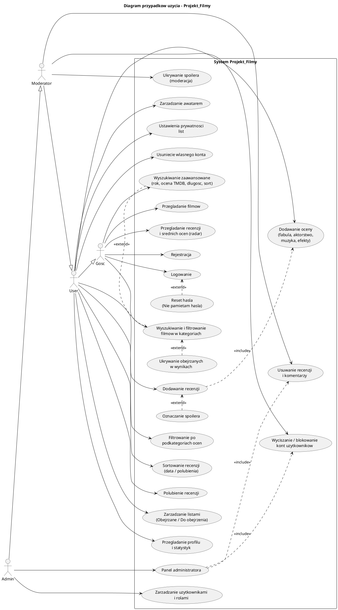
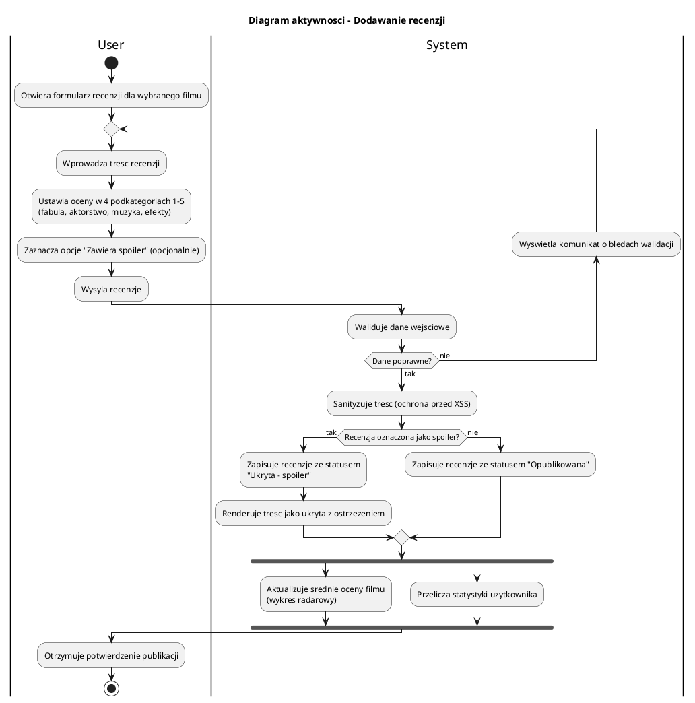
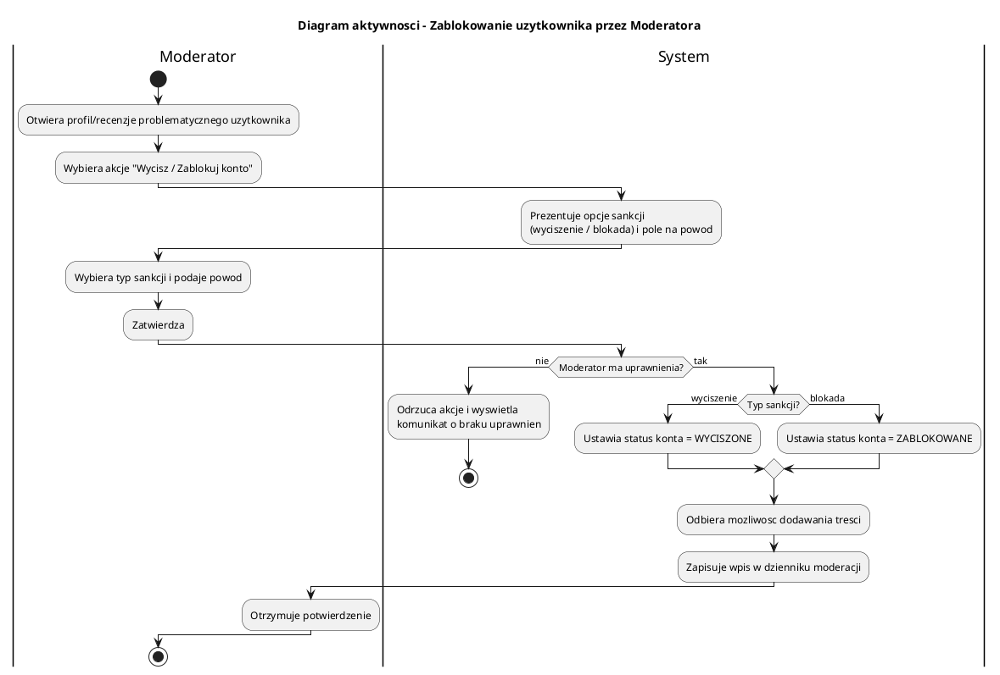
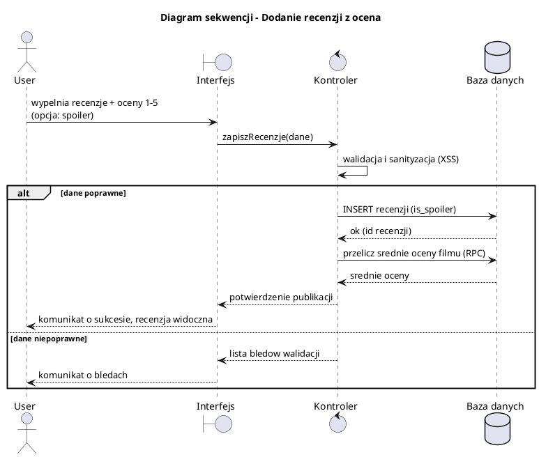
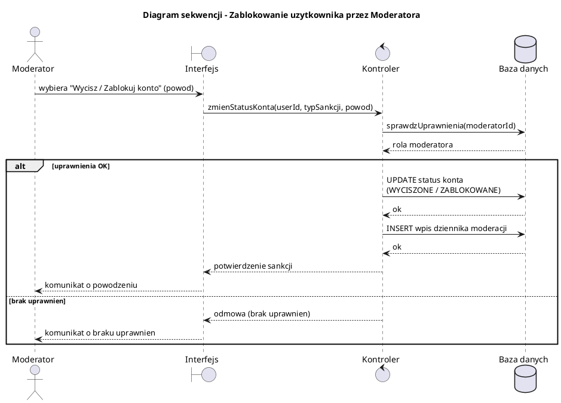
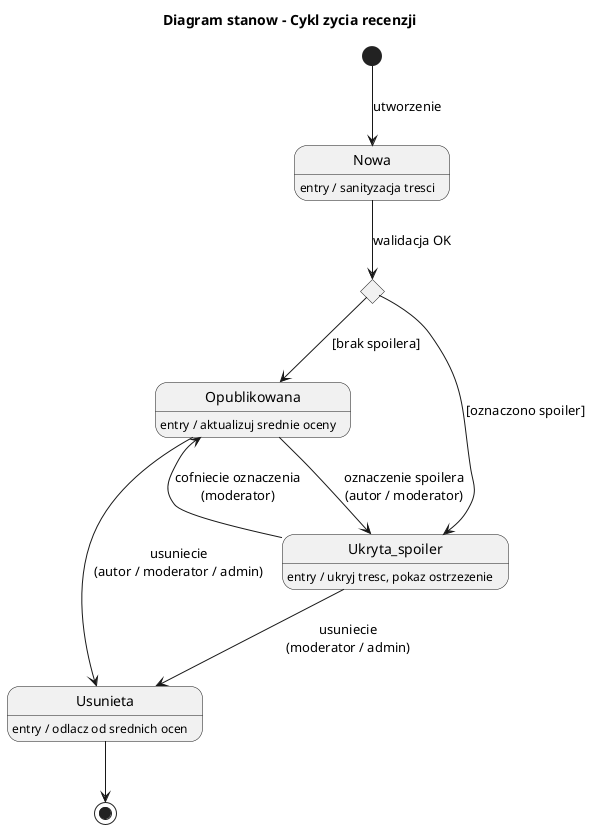
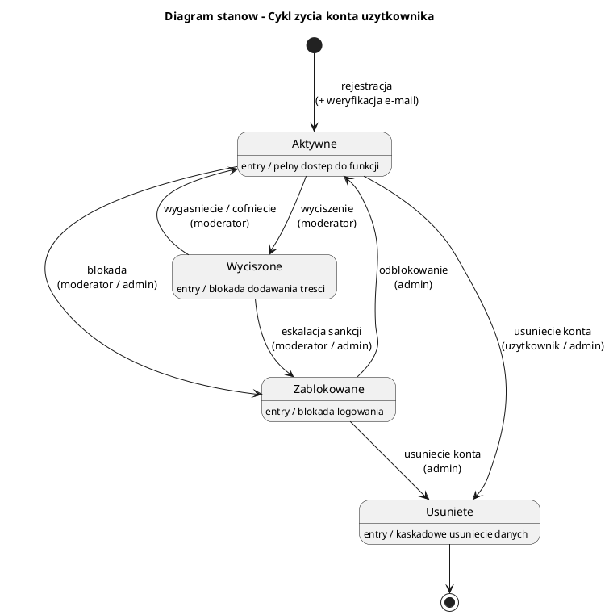
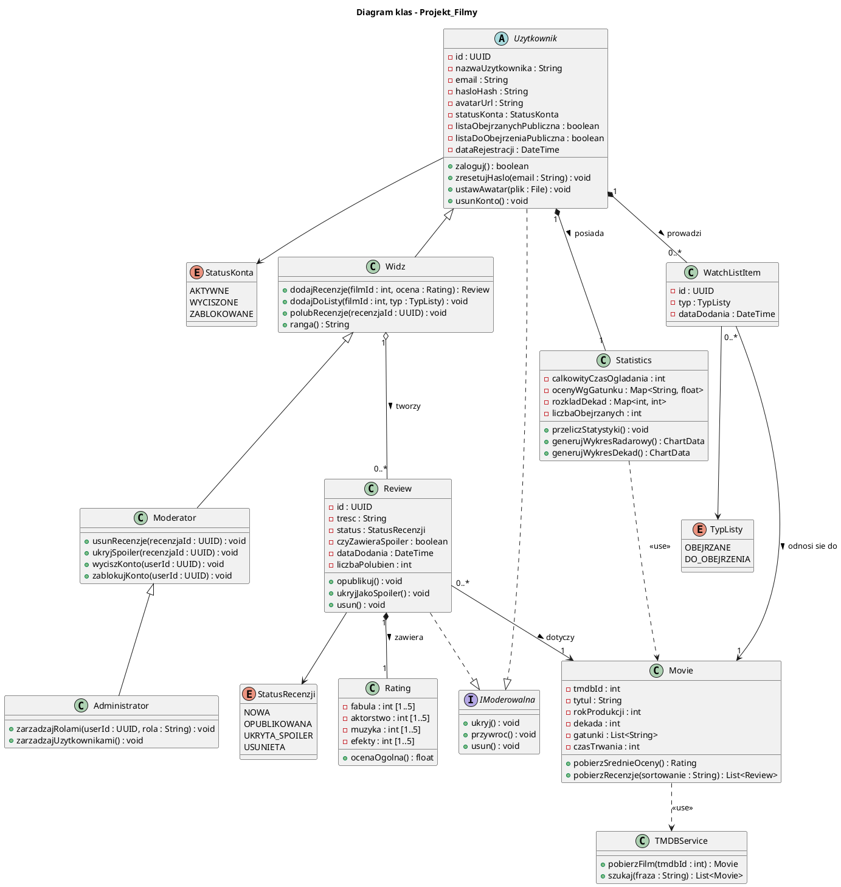

# Dokumentacja projektowa systemu „Projekt_Filmy"

Serwis internetowy do przeglądania filmów, wielowymiarowego oceniania, pisania recenzji oraz śledzenia statystyk oglądania.
Repozytorium: https://github.com/oskarzegar/Projekt_Filmy
Stos technologiczny: Node.js / Express (backend), Supabase / PostgreSQL (dane użytkowników, ocen i recenzji), TMDB API (źródło danych o filmach).

---

## Sekcja 1: Wstęp i Analiza Problemu

### 1.1. Opis „świata rzeczywistego" i kontekst biznesowy

Współczesny widz ma dostęp do bezprecedensowo dużej liczby filmów rozproszonych po wielu platformach VOD, w kinach i archiwach. Paradoksalnie, im więcej obejrzanych tytułów, tym trudniej zapanować nad własnym „śladem filmowym". Kluczowe problemy, z którymi mierzą się użytkownicy w organizacji obejrzanych filmów, to:

- **Rozproszenie informacji** – notatki o obejrzanych filmach trzymane są w pamięci, w aplikacjach do notatek, w arkuszach kalkulacyjnych i na różnych platformach jednocześnie. Brak jednego, spójnego miejsca prowadzi do dublowania i utraty danych.
- **Problem „czy ja to już widziałem?"** – przy dużej liczbie obejrzanych tytułów użytkownicy przypadkowo rozpoczynają oglądanie filmu, który już znają, marnując czas.
- **Spłaszczona ocena** – większość serwisów pozwala wystawić jedną, ogólną ocenę liczbową. Tymczasem realny odbiór filmu jest wielowymiarowy: film może mieć znakomitą muzykę i efekty, lecz słabą fabułę. Pojedyncza liczba zaciera tę informację.
- **Spoilery w recenzjach** – czytanie recenzji przed seansem niesie ryzyko natknięcia się na zdradzające fabułę treści, co psuje doświadczenie.
- **Brak wglądu we własne nawyki** – użytkownicy nie mają łatwego dostępu do podsumowania, ile czasu poświęcili na oglądanie, jakie gatunki preferują ani z jakich dekad pochodzą ich filmy.
- **Brak narzędzi moderacyjnych w mniejszych społecznościach** – nieformalne grupy filmowe nie dysponują mechanizmami usuwania nieodpowiednich treści czy wyciszania problematycznych kont.

Główni interesariusze systemu: **widz okazjonalny** (chce prostego dziennika i listy „do obejrzenia"), **kinofil/entuzjasta** (chce zaawansowanych statystyk i zniuansowanej oceny), **moderacja społeczności** (dba o jakość treści) oraz **administrator** (zarządza systemem i uprawnieniami).

### 1.2. Analiza istniejących rozwiązań

| Rozwiązanie | Mocne strony | Braki istotne dla naszego projektu |
|---|---|---|
| **IMDb** | Największa baza filmów, rozbudowane metadane, globalny zasięg. | Ocena jednowymiarowa (1–10); przeładowany interfejs; szczątkowe statystyki osobiste; brak rozbicia oceny na podkategorie; intensywne reklamy. |
| **Filmweb** | Silna polska społeczność, lokalne recenzje, oceny 1–10. | Również ocena jednowymiarowa; statystyki profilu ograniczone; oznaczanie spoilerów ręczne i niespójne; brak wizualizacji preferencji (radar, dekady). |
| **Letterboxd** | Doskonałe śledzenie obejrzanych (dziennik, listy), estetyka, kultura recenzji. | Ocena w skali 0,5–5 gwiazdek (jednowymiarowa); zaawansowane statystyki dostępne wyłącznie w płatnym planie Pro/Patron; brak rozbicia oceny na aktorstwo/muzykę/efekty/fabułę. |

**Nisza, którą wypełnia „Projekt_Filmy":** połączenie **wielowymiarowej oceny** (cztery wprowadzane podkategorie w skali 1–5: aktorstwo, muzyka, efekty, fabuła; ocena ogólna wyliczana jako ich średnia) z **bogatą, bezpłatną wizualizacją statystyk** (wykres radarowy preferencji gatunkowych, rozkład dekad, czas oglądania) oraz **wbudowanym mechanizmem oznaczania i ukrywania spoilerów**. Dodatkowo serwis nie utrzymuje własnej bazy filmów – korzysta z TMDB API, co pozwala skupić się na warstwie społecznościowej i analitycznej.

---

## Sekcja 2: Opis Biznesowy i Wymagania

### 2.1. Główne cele biznesowe

1. Umożliwić użytkownikom prowadzenie jednego, spójnego, **wielowymiarowego dziennika filmowego**.
2. Dostarczyć **wgląd w nawyki oglądania** poprzez czytelne wizualizacje statystyk.
3. Zbudować **moderowaną społeczność** opartą na recenzjach, polubieniach i kontroli jakości treści.
4. Wykorzystać **TMDB** jako zewnętrzne źródło danych o filmach, ograniczając koszt utrzymania własnej bazy tytułów.
5. Zapewnić **przejrzysty i bezpieczny** sposób obsługi danych użytkownika (kont, ocen, recenzji).

### 2.2. Wymagania funkcjonalne

#### A. Konto i uwierzytelnianie
| ID | Wymaganie | Priorytet |
|---|---|---|
| WF-01 | System umożliwia rejestrację nowego konta (nazwa użytkownika, e-mail, hasło). | Wysoki |
| WF-02 | System umożliwia logowanie w modalu logowania/rejestracji. | Wysoki |
| WF-03 | Modal logowania udostępnia opcję **„Nie pamiętam hasła"** inicjującą proces resetu hasła. | Średni |
| WF-20 | Zalogowany użytkownik może **usunąć własne konto** wraz z powiązanymi danymi. | Średni |

#### B. Przeglądanie i wyszukiwanie filmów
| ID | Wymaganie | Priorytet |
|---|---|---|
| WF-04 | System umożliwia przeglądanie i wyszukiwanie filmów w oparciu o dane z TMDB. | Wysoki |
| WF-05 | System umożliwia **sortowanie i filtrowanie wyników w kategoriach**. | Wysoki |
| WF-06 | System umożliwia **ukrywanie filmów już obejrzanych** w wynikach przeglądania. | Średni |
| WF-07 | Karta filmu prezentuje **średnie oceny serwisu na wykresie radarowym** (podział na podkategorie). | Wysoki |
| WF-21 | **Wyszukiwanie zaawansowane** umożliwia filtrowanie po: roku produkcji, ocenie TMDB, długości filmu oraz ocenie serwisu (minimum), z wyborem sposobu sortowania wyników. | Średni |
| WF-25 | System **ogranicza widoczność filmów według wieku** zalogowanego użytkownika (data urodzenia podawana przy rejestracji, widoczna tylko dla właściciela konta): filmy z klasyfikacją wiekową (PL, a przy jej braku US/GB/DE/FR) powyżej wieku użytkownika są blokowane; przy nieznanym wieku blokowane są tylko treści 18+. | Średni |

#### C. Oceny i recenzje
| ID | Wymaganie | Priorytet |
|---|---|---|
| WF-08 | System umożliwia wystawienie oceny w czterech podkategoriach (skala 1–5): **fabuła, aktorstwo, muzyka, efekty**. Ocena ogólna jest wyliczana jako średnia tych czterech wartości. | Wysoki |
| WF-09 | System umożliwia **filtrowanie po podkategoriach ocen** (fabuła, aktorstwo, muzyka, efekty) oraz po ocenie ogólnej (średniej społeczności). | Średni |
| WF-10 | Zalogowany użytkownik może dodawać recenzje/komentarze do filmów. | Wysoki |
| WF-11 | System umożliwia **oznaczanie recenzji jako zawierającej spoiler oraz jej ukrywanie**. | Wysoki |
| WF-12 | System umożliwia **sortowanie recenzji wg daty dodania oraz liczby polubień/pomocnych ocen**. | Średni |

#### D. Listy i profil użytkownika
| ID | Wymaganie | Priorytet |
|---|---|---|
| WF-13 | Użytkownik prowadzi listy **„Obejrzane"** i **„Do obejrzenia"**. | Wysoki |
| WF-14 | Profil prezentuje **rozbudowane statystyki**: czas spędzony na oglądaniu, wykres radarowy preferencji gatunkowych, wykres rozkładu dekad. | Wysoki |
| WF-22 | Użytkownik może ustawić **zdjęcie profilowe (awatar)** – upload do magazynu plików (limit 2 MB, formaty JPG/PNG/WebP). | Niski |
| WF-23 | Użytkownik może określić **prywatność list** „Obejrzane" i „Do obejrzenia" (publiczna/prywatna). | Średni |
| WF-24 | System nadaje użytkownikowi **rangę** na podstawie liczby otrzymanych pomocnych głosów (Recenzent → Krytyk → Ekspert → Filmoznawca). | Niski |

#### E. Moderacja i administracja
| ID | Wymaganie | Priorytet |
|---|---|---|
| WF-15 | System realizuje **kontrolę dostępu opartą na rolach**: Gość, User, Moderator, Admin. | Wysoki |
| WF-16 | **Moderator** może usuwać komentarze oraz nakładać blokady. | Wysoki |
| WF-17 | Uprawnione role mogą **zarządzać zawartością**: usuwać recenzje, ukrywać spoilery, **blokować/wyciszać konta** użytkowników. | Wysoki |
| WF-18 | **Admin** posiada pełny dostęp przez panel administratora (zarządzanie użytkownikami, rolami i treściami). | Wysoki |

### 2.3. Wymagania niefunkcjonalne

- **Wydajność:** wyniki wyszukiwania/filtrowania powinny być prezentowane w czasie nieprzekraczającym ok. 3 s; dane z TMDB powinny być buforowane (cache) w celu ograniczenia liczby zapytań i opóźnień.
- **Bezpieczeństwo:** hasła przechowywane wyłącznie w postaci skrótów (hashowanie); komunikacja po HTTPS/TLS; **sanityzacja i escaping treści recenzji** w celu ochrony przed atakami XSS; **ograniczanie liczby zapytań (rate limiting)** do warstwy proxy TMDB; kontrola dostępu egzekwowana po stronie serwera (RBAC), a nie wyłącznie w interfejsie.
- **Niezawodność:** awaria lub spowolnienie usług zewnętrznych (TMDB, Supabase) ani nieprawidłowe dane wejściowe nie mogą przerwać pracy serwera — zapytania do TMDB mają limit czasu (8 s), a błędy są zwracane jako czytelne komunikaty (JSON, bez szczegółów technicznych); wygasłe kary czasowe są zdejmowane automatycznie.
- **Użyteczność:** interfejs responsywny i intuicyjny; czytelne wizualizacje (wykresy radarowe, rozkład dekad); spójne, jednoznaczne oznaczanie spoilerów.
- **Kompatybilność:** poprawne działanie w aktualnych wersjach popularnych przeglądarek (Chrome, Firefox, Edge, Safari) oraz na urządzeniach mobilnych (projekt responsywny).

---

## Sekcja 3: Modelowanie Systemu

### 3.1. Aktorzy i ich główne przypadki użycia

| Aktor | Główne przypadki użycia |
|---|---|
| **Gość** | Przeglądanie i wyszukiwanie filmów, podgląd publicznych recenzji i średnich ocen, rejestracja, logowanie, reset hasła. |
| **User** (zalogowany) | Wszystko, co Gość, oraz: wystawianie ocen w podkategoriach, dodawanie recenzji, oznaczanie spoilerów, prowadzenie list „Obejrzane"/„Do obejrzenia", polubienia recenzji, przeglądanie własnego profilu i statystyk. |
| **Moderator** | Wszystko, co User, oraz: usuwanie komentarzy i recenzji, ukrywanie spoilerów, wyciszanie i blokowanie kont użytkowników. |
| **Admin** | Pełny dostęp: wszystkie funkcje Moderatora oraz zarządzanie użytkownikami i rolami przez panel administratora. |

### 3.2. Diagram przypadków użycia

Relacje warte uzasadnienia na obronie:
- `Reset hasla` **extend** `Logowanie` – opcjonalnie uruchamiany z modala logowania.
- `Dodawanie recenzji` **include** `Dodawanie oceny` – recenzja zawsze niesie ocenę w podkategoriach (spójne z kompozycją `Review *-- Rating`).
- `Oznaczanie spoilera` **extend** `Dodawanie recenzji` – krok opcjonalny.
- `Ukrywanie obejrzanych` **extend** `Wyszukiwanie/filtrowanie` – opcja warunkowa nad bazowym filtrowaniem; dostępna wyłącznie dla zalogowanych (Gość nie ma listy „Obejrzane").
- `Wyszukiwanie zaawansowane` **extend** `Wyszukiwanie/filtrowanie` – rozszerza podstawowe wyszukiwanie o dodatkowe kryteria (rok, ocena TMDB, długość, ocena serwisu, sortowanie).
- `Panel administratora` **include** akcje moderacyjne – Admin korzysta z nich w ramach pełnego dostępu.

### 3.3. Scenariusz 1 – Dodanie recenzji z oceną

| Element | Opis |
|---|---|
| **Nazwa scenariusza** | Dodanie recenzji z oceną (UC-Rev01) |
| **Aktor** | User (zalogowany użytkownik) |
| **Cel** | Dodanie recenzji wybranego filmu wraz z oceną w podkategoriach i opcjonalnym oznaczeniem spoilera. |
| **Warunki początkowe** | Użytkownik jest zalogowany, jego konto jest aktywne (nie wyciszone/zablokowane), a film istnieje w katalogu (dane z TMDB). |
| **Przebieg główny** | 1. Użytkownik otwiera kartę filmu i wybiera „Dodaj recenzję". 2. Wprowadza treść recenzji. 3. Ustawia oceny w czterech podkategoriach (skala 1–5): fabuła, aktorstwo, muzyka, efekty. 4. (Opcjonalnie) zaznacza „Zawiera spoiler". 5. Wysyła recenzję. 6. System waliduje i sanityzuje dane wejściowe. 7. System zapisuje recenzję ze statusem „Opublikowana". 8. System aktualizuje średnie oceny filmu (wykres radarowy) oraz przelicza statystyki użytkownika. 9. System wyświetla potwierdzenie. |
| **Scenariusz alternatywny** | **Krok 6 – dane niepoprawne:** system wyświetla komunikat o błędach walidacji i umożliwia korektę (powrót do kroku 2). **Krok 4 – zaznaczono spoiler:** w kroku 7 recenzja zapisywana jest ze statusem „Ukryta – spoiler", a jej treść renderowana jest jako ukryta wraz z ostrzeżeniem. |
| **Warunki końcowe** | Recenzja jest zapisana w bazie z odpowiednim statusem; średnie oceny filmu i statystyki użytkownika są zaktualizowane – albo użytkownik widzi komunikat o błędzie. |

### 3.4. Scenariusz 2 – Zablokowanie użytkownika przez Moderatora

| Element | Opis |
|---|---|
| **Nazwa scenariusza** | Zablokowanie/wyciszenie użytkownika przez Moderatora (UC-Mod01) |
| **Aktor** | Moderator |
| **Cel** | Ograniczenie aktywności użytkownika naruszającego zasady poprzez wyciszenie lub zablokowanie jego konta. |
| **Warunki początkowe** | Moderator jest zalogowany i posiada rolę Moderator lub Admin; konto docelowego użytkownika istnieje. |
| **Przebieg główny** | 1. Moderator otwiera profil lub recenzję problematycznego użytkownika. 2. Wybiera akcję „Wycisz/Zablokuj konto". 3. System prezentuje opcje (wyciszenie czasowe / blokada) i pole na powód. 4. Moderator wybiera typ sankcji i zatwierdza. 5. System weryfikuje uprawnienia Moderatora. 6. System zmienia status konta na „Wyciszone" lub „Zablokowane". 7. System odbiera użytkownikowi możliwość dodawania treści. 8. System wyświetla potwierdzenie. |
| **Scenariusz alternatywny** | **Krok 5 – brak uprawnień** (np. próba sankcji wobec Admina lub konta o równej/wyższej roli): system odrzuca akcję i wyświetla komunikat o braku uprawnień. **Krok 4 – anulowanie:** Moderator przerywa operację; status konta pozostaje bez zmian. **Krok 4 – nieprawidłowy termin kary:** system odrzuca żądanie z komunikatem o nieprawidłowej dacie; status konta pozostaje bez zmian. **Krok 6 – awaria bazy danych lub połączenia:** system wyświetla komunikat o niepowodzeniu; status konta pozostaje bez zmian. **Krok 6 – blokada logowania nie powiodła się** (status zapisany, ale usługa uwierzytelniania odrzuciła blokadę): system informuje o częściowym powodzeniu, aby Moderator mógł ponowić operację. |
| **Warunki końcowe** | Konto docelowe ma status „Wyciszone" lub „Zablokowane", a jego możliwość publikowania treści jest ograniczona zgodnie z sankcją – albo operacja została odrzucona/anulowana i status pozostał bez zmian. |

---

> Kody są zapisane w standardowej składni PlantUML. W razie problemów z importem do Software Ideas Modeler można je zweryfikować/wyrenderować na https://plantuml.com/.

> **Uwaga – decyzje modelu danych (spójne ze schematem Supabase):**
> - **Ocena ogólna** jest wartością wyliczaną (średnia z czterech ocen `rating_plot`, `rating_acting`, `rating_music`, `rating_effects` w skali 1–5; agregacja realizowana przez funkcję RPC `movies_by_community_rating`), a nie osobnym polem wprowadzanym przez użytkownika.
> - **Movie** to encja logiczna/zewnętrzna – dane filmów pochodzą z TMDB; w bazie utrwalane są jedynie referencje (`movie_id`, `movie_title`, `poster_path`), bez dedykowanej tabeli filmów.
> - **Statistics** to model logiczny – statystyki (czas oglądania, rozkład gatunków i dekad) są wyznaczane w czasie działania na podstawie listy `watched` oraz danych z TMDB.
> - **Status recenzji** (diagram stanów) reprezentuje logiczny cykl życia recenzji; w warstwie danych odwzorowywany jest przez flagę `is_spoiler` (stan „Ukryta – spoiler") oraz istnienie/usunięcie rekordu (stan „Usunięta").

### 3.5. Diagram aktywności – Dodawanie recenzji (z podziałem User / System i sprawdzeniem spoilera)

### 3.6. Diagram aktywności – Zablokowanie użytkownika przez Moderatora

### 3.7. Diagram sekwencji – Dodanie recenzji z oceną

### 3.8. Diagram sekwencji – Zablokowanie użytkownika przez Moderatora

### 3.9. Diagram stanów – Cykl życia obiektu „Recenzja"

### 3.10. Diagram stanów – Cykl życia obiektu „Konto użytkownika"

## Sekcja 4: Technologie i wymagania sprzętowe

### 4.1. Stos technologiczny

System został zbudowany w architekturze klient–serwer z chmurowym zapleczem danych (BaaS). Warstwa serwera to lekki backend Node.js/Express, który serwuje statyczny frontend oraz pełni rolę proxy do zewnętrznego API filmowego; dane użytkowników, uwierzytelnianie i pliki obsługuje Supabase.

| Warstwa | Technologia | Rola |
|---|---|---|
| Serwer aplikacji | Node.js 22, Express 4 (ES Modules) | Serwowanie frontendu, proxy do TMDB, REST API (`/api`: filmy, profile, statystyki, rekomendacje, klasyfikacje wiekowe, konfiguracja klienta), panel moderacji z RBAC (`/api/admin`), zadanie cykliczne zdejmowania wygasłych kar (`/api/cron`) |
| Warstwa serwera | `routes/` (routing HTTP) + `lib/` (logika biznesowa i dostęp do danych) | Trasy obsługują tylko przepływ HTTP; statystyki, rekomendacje, klasyfikacje wiekowe i czyszczenie kar są w modułach `lib/`, a jedynymi modułami wysyłającymi zapytania do Supabase i TMDB są `lib/supabaseRest.js` i `lib/tmdb.js` |
| Konfiguracja / dokumentacja API | `dotenv`, `swagger-ui-express` | Zmienne środowiskowe (`.env`); dokumentacja API pod `/api/docs` |
| Proxy danych filmowych | `routes/tmdb.js` + `lib/tmdb.js` | Pośredniczenie w zapytaniach do `api.themoviedb.org/3`; klucz `TMDB_API_KEY` doklejany po stronie serwera (nie trafia do przeglądarki); język `pl`; whitelist ścieżek, cache 10 min, limit czasu 8 s, limit 600 zapytań/min na adres IP |
| Frontend | Statyczny HTML (katalog `public/`) + czysty JavaScript (moduły ES, bez frameworka) | Interfejs użytkownika; preferencja motywu jasny/ciemny w `localStorage` |
| Uwierzytelnianie | Supabase Auth | Rejestracja i logowanie (e-mail + hasło), weryfikacja e-mail, reset hasła |
| Baza danych | Supabase PostgreSQL | 7 tabel + funkcje RPC + Row Level Security (RLS) + granty kolumnowe |
| Magazyn plików | Supabase Storage (bucket `avatars`) | Zdjęcia profilowe – publiczny bucket, limit 2 MB, formaty JPG/PNG/WebP |
| Klient bazy | `@supabase/supabase-js` v2 (ładowany przez ESM) | Komunikacja frontendu z Supabase; klucze (URL + anon key) pobierane z `/api/config` |
| Źródło danych o filmach | TMDB API (The Movie Database) | Katalog filmów, metadane, plakaty, gatunki |

### 4.2. Wymagania sprzętowe i środowiskowe

**Serwer / hosting (orientacyjnie, minimalne):**
- środowisko uruchomieniowe Node.js w wersji LTS (≥ 18; aplikacja rozwijana na 22),
- ok. 512 MB RAM i kilkaset MB przestrzeni dyskowej (sam backend jest lekki),
- stały dostęp do Internetu z możliwością połączenia z `api.themoviedb.org` oraz instancją Supabase,
- baza danych i magazyn plików działają w chmurze Supabase – nie jest wymagany własny serwer bazodanowy.

**Klient (użytkownik końcowy):**
- dowolne urządzenie (komputer, tablet, smartfon) z aktualną przeglądarką obsługującą moduły ES i `fetch` (Chrome, Firefox, Edge, Safari),
- aktywne łącze internetowe; brak konieczności instalacji oprogramowania,
- interfejs responsywny – poprawne działanie na ekranach desktopowych i mobilnych.

**Środowisko deweloperskie:**
- Node.js + npm, konto Supabase (URL + klucze), klucz TMDB API, edytor kodu (np. VS Code),
- konfiguracja sekretów w pliku `.env` (`TMDB_API_KEY`, dane Supabase).

## Sekcja 5: Struktura systemu

### 5.1. Opis bazy danych

Baza działa w PostgreSQL (Supabase) i składa się z siedmiu tabel w schemacie `public` (sześć tabel schematu bazowego oraz dziennik moderacji) i funkcji RPC. Na każdej tabeli włączony jest mechanizm Row Level Security (RLS), egzekwujący dostęp po stronie bazy. Dane o filmach nie są przechowywane w osobnej tabeli – utrwalane są jedynie referencje do TMDB (`movie_id`, `movie_title`, `poster_path`), a pełne informacje pobierane są z TMDB API.

**`profiles`** – profil użytkownika powiązany 1:1 z kontem `auth.users`.
- `id` (UUID, PK, FK → `auth.users`, `ON DELETE CASCADE`), `email`, `display_name`, `avatar_url`, `watchlist_public` (BOOL, domyślnie `false`), `watched_public` (BOOL, domyślnie `false`), `created_at`.
- Kolumny RBAC i moderacji: `role` (`user` / `moderator` / `admin`, domyślnie `user`), `account_status` (`active` / `muted` / `blocked`, domyślnie `active`), `muted_until` (TIMESTAMPTZ — termin wygaśnięcia kary; `NULL` przy karze na stałe).
- `birth_date` (DATE) — data urodzenia do filtra treści wg wieku (WF-25); kolumna prywatna, dostępna wyłącznie dla właściciela przez funkcje `get_my_birth_date` / `set_my_birth_date`.
- RLS: odczyt i edycja własnego profilu; publiczny odczyt `display_name`/`avatar_url` (dla publicznych profili). Trigger `handle_new_user()` zakłada profil automatycznie po rejestracji. **Granty kolumnowe** uzupełniają RLS: kolumn `role`, `account_status` i `muted_until` nie da się zapisać z przeglądarki (zmieniają je wyłącznie funkcje `set_user_role` / `set_account_status`), a `email` i `birth_date` nie są czytelne dla klienta.

**`watchlist`** – lista „Do obejrzenia".
- `id` (UUID, PK), `user_id` (FK → `profiles`, cascade), `movie_id` (INT, TMDB), `movie_title`, `poster_path`, `added_at`. Ograniczenie `UNIQUE(user_id, movie_id)`.
- RLS: właściciel ma pełen dostęp; pozycje widoczne publicznie, gdy `watchlist_public = true`.

**`watched`** – lista „Obejrzane".
- Struktura analogiczna do `watchlist`, z `watched_at` zamiast `added_at`. `UNIQUE(user_id, movie_id)`.
- RLS: właściciel + publiczny odczyt przy `watched_public = true`.

**`reviews`** – recenzje z oceną wielokryterialną.
- `id` (UUID, PK), `user_id` (FK, cascade), `movie_id`, `movie_title`, `rating_plot`, `rating_acting`, `rating_music`, `rating_effects` (SMALLINT, `CHECK BETWEEN 1 AND 5`), `review_text`, `is_spoiler` (BOOL, domyślnie `false`), `created_at`, `updated_at`. `UNIQUE(user_id, movie_id)` – jeden użytkownik może mieć jedną recenzję danego filmu.
- RLS: odczyt publiczny (`USING (true)`); dodawanie/edycja/usuwanie tylko przez autora (`auth.uid() = user_id`).

**`review_votes`** – głosy „pomocne / niepomocne".
- `id`, `review_id` (FK, cascade), `user_id` (FK, cascade), `is_helpful` (BOOL), `created_at`. `UNIQUE(review_id, user_id)` – jeden głos na recenzję na użytkownika.
- RLS: odczyt publiczny; modyfikacja tylko własnych głosów. Liczba pomocnych głosów stanowi podstawę systemu rang użytkownika.

**`review_comments`** – komentarze pod recenzjami.
- `id`, `review_id` (FK, cascade), `user_id` (FK, cascade), `body` (TEXT, `CHECK char_length BETWEEN 1 AND 500`), `created_at`.
- RLS: odczyt publiczny; dodawanie/usuwanie tylko przez autora.

Moderator i Administrator mogą dodatkowo usuwać cudze recenzje i komentarze oraz zmieniać flagę spoilera (polityki RLS moderacji), a konta wyciszone lub zablokowane nie mogą publikować treści (`can_post()`).

**`moderation_log`** – dziennik działań moderacji.
- `id` (UUID, PK), `moderator_id` (FK → `profiles`, `ON DELETE SET NULL`), `target_user_id` (FK → `profiles`, cascade), `target_review_id` (UUID, bez FK — recenzja mogła zostać usunięta), `action` (np. `status:muted`, `role:moderator`, `review:delete`), `reason`, `created_at`.
- RLS: odczyt dla Moderatora/Administratora; ukarany użytkownik widzi własne wpisy (powód kary w banerze).

**Funkcje RPC:**
- `handle_new_user()` – trigger zakładający profil po rejestracji konta (wraz z datą urodzenia podaną przy rejestracji).
- `delete_user()` – usuwa konto użytkownika wraz z kaskadowo powiązanymi danymi.
- `movies_by_community_rating(min_rating)` – zwraca filmy, których średnia z czterech ocen (`plot`, `acting`, `music`, `effects`) jest nie mniejsza niż `min_rating`; stanowi podstawę filtra „ocena serwisu".
- `movie_community_rating` – średnie ocen podkategorii jednego filmu (radar, WF-07); `movies_by_community_rating_multi` – filtr po czterech kryteriach i ocenie ogólnej (WF-09).
- `user_rank_info` – rola i liczba pomocnych głosów użytkownika (rangi, WF-24).
- `current_user_role`, `is_admin`, `is_moderator`, `can_post` – funkcje pomocnicze RBAC używane w politykach RLS.
- `set_account_status` / `set_user_role` – zmiana statusu konta (z terminem kary) i roli z egzekwowaniem hierarchii ról w bazie oraz wpisem do dziennika moderacji.
- `get_my_birth_date` / `set_my_birth_date` – odczyt i zapis własnej daty urodzenia (z walidacją zakresu).
- `sweep_expired_sanctions` – zdejmuje wygasłe kary czasowe (czas z zegara bazy) i zapisuje wpis w dzienniku; wywoływana przez serwer (Vercel Cron) lub harmonogram `pg_cron`.

**Integralność i bezpieczeństwo:** wszystkie tabele potomne korzystają z `ON DELETE CASCADE` – usunięcie konta kasuje jego listy, recenzje, głosy i komentarze, a usunięcie recenzji kasuje powiązane z nią głosy i komentarze. RLS gwarantuje, że użytkownik modyfikuje wyłącznie własne dane, podczas gdy recenzje, głosy i komentarze są publicznie czytelne. Klucz TMDB jest ukryty za proxy serwera, a po stronie klienta wykorzystywany jest wyłącznie publiczny klucz `anon` Supabase (zgodnie z modelem bezpieczeństwa Supabase opartym na RLS).

### 5.2. Diagram ERD

Diagram związków encji (ERD) odwzorowujący powyższe tabele i relacje jest dostępny w panelu Supabase (Database → Schema Visualizer) i stanowi graficzne uzupełnienie opisu z sekcji 5.1.

### 5.3. Diagram klas (User, Movie, Review, Rating, Statistics i powiązane)

**Uzasadnienie relacji:**
- **Generalizacja** `Widz` → `Moderator` → `Administrator` (dziedziczenie z abstrakcyjnej klasy `Uzytkownik`) – odzwierciedla hierarchię uprawnień; każda kolejna rola dziedziczy operacje poprzedniej i dodaje własne. Zastępuje wcześniejszy enum `Rola`, ponieważ to generalizacja jest konstrukcją wymaganą w Software Ideas Modeler.
- **Realizacja interfejsu** `Review ..|> IModerowalna` oraz `Uzytkownik ..|> IModerowalna` – obie klasy podlegają tym samym akcjom moderacyjnym (ukryj/przywróć/usuń), więc współdzielą wspólny kontrakt.
- **Zależność** `Movie ..> TMDBService` i `Statistics ..> Movie` (`<<use>>`) – `Movie` korzysta z zewnętrznej usługi TMDB do pobrania danych, a `Statistics` używa danych filmów (czas trwania, dekada) do przeliczeń, bez trwałego powiązania strukturalnego.
- **Kompozycja** `Uzytkownik *-- Statistics` oraz `Uzytkownik *-- WatchListItem` – statystyki i wpisy na listach nie istnieją bez właściciela; są tworzone i usuwane razem z kontem.
- **Kompozycja** `Review *-- Rating` – ocena w podkategoriach jest integralną częścią recenzji.
- **Agregacja** `Widz o-- Review` – recenzje są powiązane z autorem, ale ze względów moderacyjnych mogą być utrzymywane niezależnie od cyklu życia konta.
- **Asocjacja** `Review --> Movie` i `WatchListItem --> Movie` – film pochodzi z TMDB (zasób zewnętrzny, referencja przez `tmdbId`), więc nie jest „częścią" recenzji ani listy.

